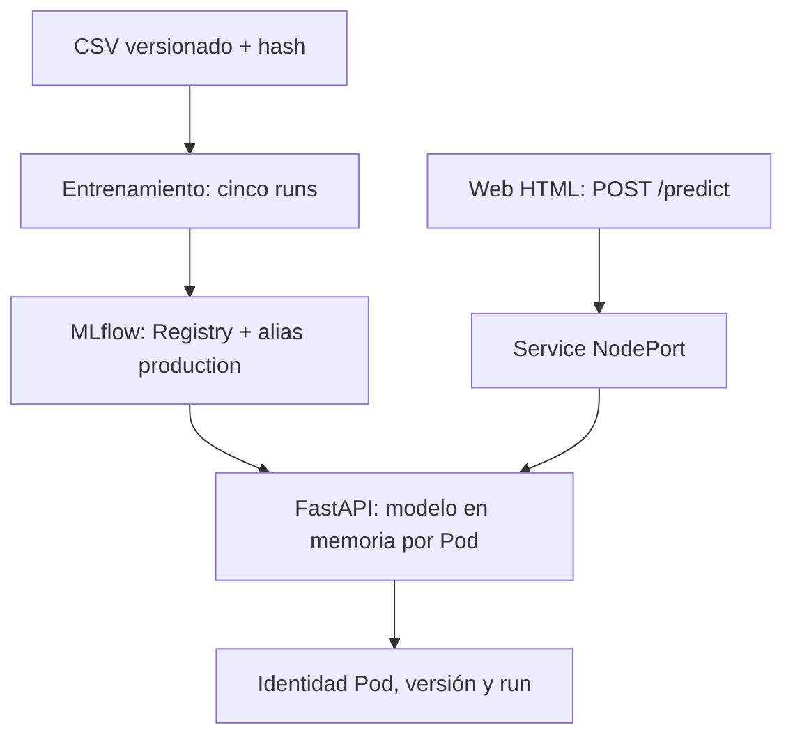

# Arquitectura, trazabilidad y modelo servido

## Identidad comprobada en esta ejecución

| Elemento | Valor |
|---|---|
| Experimento | telco-churn-individual |
| Nombre registrado | telco-churn |
| Alias | production |
| Versión servida en Kubernetes | 4 |
| Run exacto | 049f06a318534d88ab7514bb635396dd |
| Hiperparámetro C | 10.0 |
| ROC AUC validación | 0.830572 |

El modelo se sirvió mediante el Service de Kubernetes en `http://localhost:30080`.
El anexo [DESPLIEGUE.md](DESPLIEGUE.md) conserva UIDs y la identidad de la imagen;
`evidence/deployed-model.json` registra el detalle obtenido del clúster. El
comprobador de balanceo exigió coincidencia de versión y run en las respuestas.
`record-deployment.py` genera por defecto `docs/DESPLIEGUE_REAL.md`; para mantener
el nombre de este anexo después de repetir la comprobación, renombrar ese resultado
a `DESPLIEGUE.md`. Cada nuevo entrenamiento puede crear otros números de versión y
runs; en ese caso deben actualizarse estos identificadores.

## Separación de responsabilidades

MLflow almacena metadatos en SQLite y artifacts en PVC; los sirve por HTTP. La API
resuelve el alias una vez al arrancar y carga esa versión numérica inmutable. No
administra pickle/joblib manual ni copia rutas Windows dentro de los Pods.
El flavor sklearn puede serializar internamente: la gestión del artefacto sigue siendo MLflow.
El servicio inicia automáticamente con Uvicorn y usa Registry ya inicializado. Los
pasos de entrenamiento/población inicial del Registry son provisión del entorno,
no pasos manuales de cada contenedor de inferencia.

Tres réplicas FastAPI, probes y Service permiten disponibilidad horizontal. MLflow
tiene una réplica y PVC para esta práctica; una caída suya no elimina los modelos ya
cargados, pero impide nuevos arranques mientras esté indisponible. No se afirma alta
disponibilidad del plano MLflow. Para producción: DB externa, object storage,
autenticación y redundancia. El contenedor API no requiere Python instalado en el host.

## Balanceo, autorreparación y escala

NodePort 30080 expone la API; 30500 expone MLflow. POST con conexión nueva permite
que el Service seleccione otros backends. Se exigen >=3 y luego >=5 Pods distintos,
sin imponer reparto idéntico. No usar port-forward como prueba de balanceo.

`recovery.py` emite inferencias antes, durante y después de eliminar un Pod, registra
todas las solicitudes y verifica un UID nuevo Running/Ready y recuperación a tres.
Cero errores observados es el criterio; no se ocultarán fallos ni se reintenta una
solicitud fallida para hacerla parecer exitosa. Es observación finita, no prueba
matemática de uptime absoluto. preStop espera cinco segundos para favorecer el
retiro de endpoints antes de finalizar Uvicorn; el período de gracia es 30 segundos.
La prueba de escala cambia 3→5→3 y exige cinco identidades sirviendo inferencias.

## Reproducibilidad y actualización

Pipeline contiene imputación/escalado/one-hot y clasificador. Semilla 42; split
60/20/20 estratificado. Cinco configuraciones comparables seleccionadas por validación;
test no elige C. Datos con SHA256, lock transitivo y hash del script registrados.
Cambiar alias requiere rollout de Pods; no se promete cambio atómico de todas las
réplicas. Docker y las pruebas de Kubernetes se ejecutaron en Windows 11 con
Docker Desktop, como detalla [MATRIZ.md](MATRIZ.md).

## Resultados de disponibilidad

| Comprobación | Resultado observado |
|---|---|
| Balanceo inicial | 120 inferencias; tres Pods; conteos 39, 41 y 40; cero errores |
| Eliminación y reemplazo de Pod | UID nuevo; tres Ready; 152 solicitudes, 136 durante sustitución; cero fallos |
| Escala a cinco | Cinco Ready; 250 inferencias; conteos 53, 53, 47, 42 y 55; cero errores |
| Reducción | Retorno a tres Running y Ready |
| Web | POST /predict al puerto 30080; HTTP 200; versión y run coincidentes |

La prueba de escala es manual mediante `kubectl scale`, no autoescalamiento HPA.
El clúster de un nodo ofrece redundancia de procesos, sin tolerancia a pérdida del nodo.
