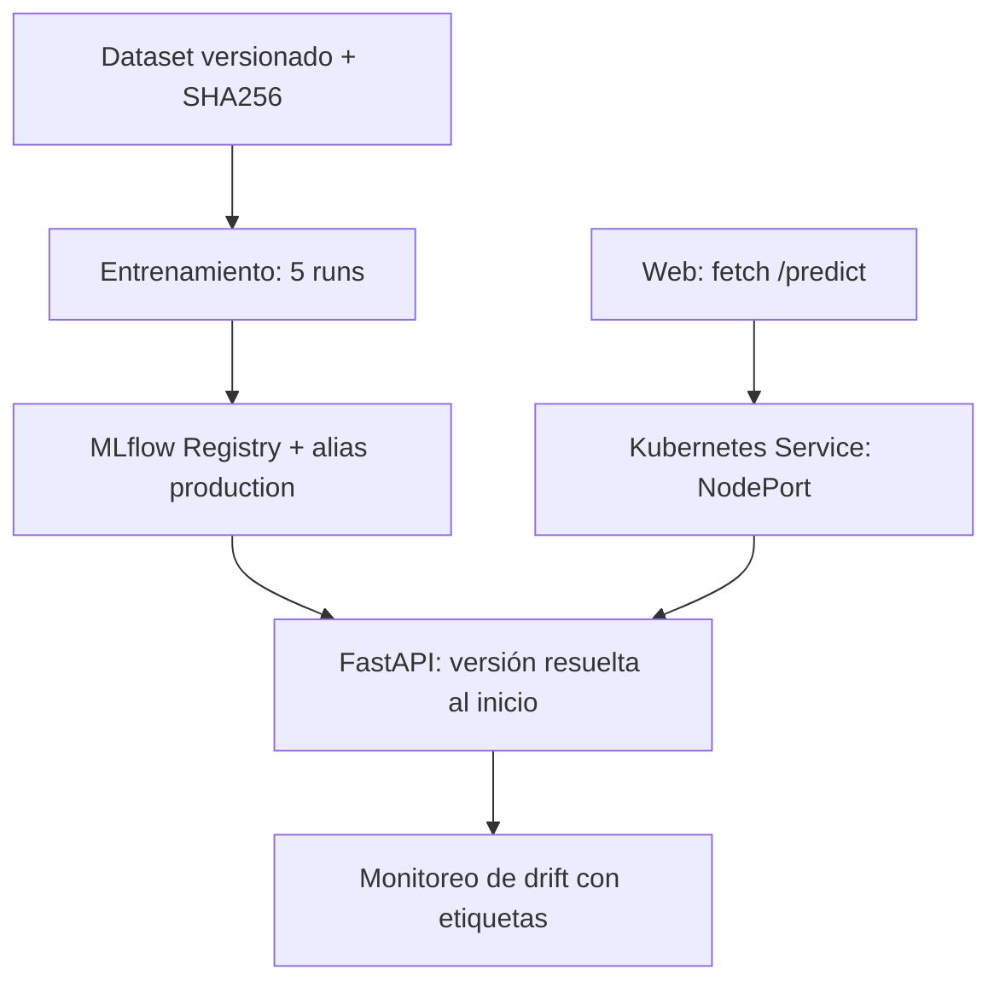

# Arquitectura y plan ejecutado

1. Inspeccionar fuentes, registrar alcance y ausencia del enunciado oficial.
2. Versionar dataset público y entorno; limpiar TotalCharges, separar 60/20/20.
3. Entrenar cinco configuraciones; registrar pipeline completo y elegir por ROC AUC de validación.
4. Promover por alias, cargar versión inmutable resuelta desde alias en FastAPI.
5. Implementar pruebas de contrato, Registry y escenarios controlados de drift.
6. Contenerizar, desplegar MLflow persistente y tres réplicas de inferencia.
7. Verificar NodePort, recuperación por UID y escalamiento 3→5→3 en Windows.
8. Completar web y evidencia de navegador, publicar GitHub y contrastar rúbrica pendiente.

MLflow se ejecuta como servicio separado con PVC; el cliente Windows y los Pods usan
HTTP para metadatos y descarga de artefactos. No se montan rutas Windows en los Pods.
El modelo sklearn se serializa internamente por MLflow; no se administra un pickle/joblib
manual ni se evita el Registry. El alias se resuelve una sola vez al arrancar para que
el número de versión reportado corresponda al objeto cargado. Cambiar alias requiere
`kubectl -n churn rollout restart deployment/churn-api` para renovar todas las réplicas.
No se promete conmutación atómica durante un rolling update.

Decisiones: regresión logística interpretable, preprocesamiento en Pipeline para evitar
fuga, imputación ajustada solo con train, seis predictores y clienteID excluido.
C = 0.01, 0.1, 1, 10, 100; semilla 42. La frontera de clasificación es 0.5.
El benchmark siempre negativo no basta para churn; se reportan ROC AUC, PR AUC y F1.
El test no se usa para escoger C; AUC test >= .75 es la compuerta mínima académica.
Para una futura promoción, comparar también contra el campeón previo en una ventana
nueva; este proyecto demuestra selección inicial, no mejora continua garantizada.
