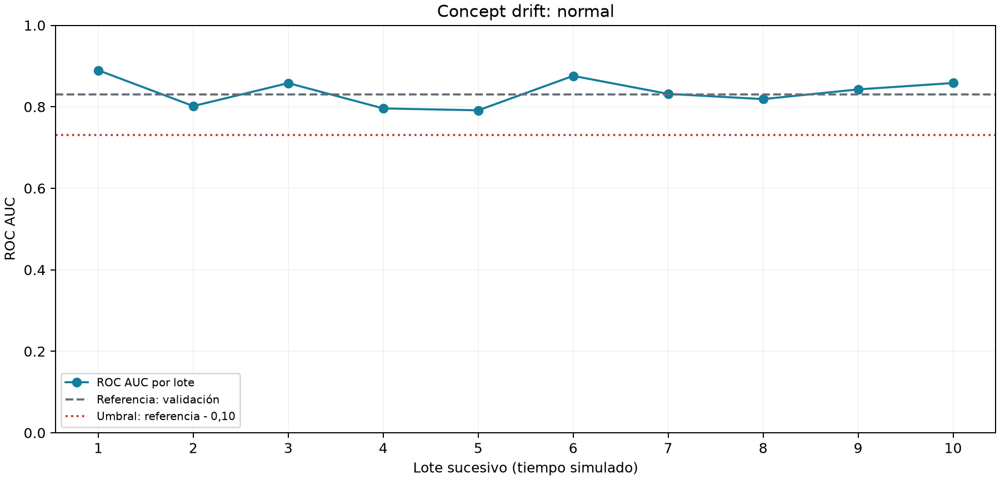
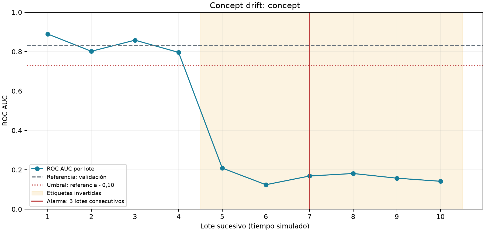

# Predicción de abandono de clientes con un flujo MLOps reproducible y observable

Maestría en Ciencia de Datos e Inteligencia Artificial — UAGRM  
Módulo: MLOps y Puesta en Producción  
Modalidad: individual, con asistencia de IA declarada  
Verificación: 5 de noviembre de 2026, Bolivia  
Estado: modelo, Registry, API y drift ejecutados en Linux; Docker/Kubernetes y
consumo web sobre clúster pendientes de ejecución en Windows.

## 1. Resumen y objetivo

Se implementó un repositorio funcional que lleva un clasificador de abandono desde
el entrenamiento hasta un servicio trazable. El énfasis, conforme al enunciado, es
la reproducibilidad, el empaquetado, la disponibilidad y la detección de degradación,
no alcanzar una exactitud máxima. Se usaron 7.043 registros del benchmark público
IBM Telco y seis predictores. Cinco configuraciones comparables se registraron en
MLflow, con cinco versiones y un alias de producción explícito. FastAPI carga el
modelo por esa referencia, sin archivos de modelo administrados manualmente.

La implementación contiene Dockerfiles propios, manifiestos Kubernetes con tres
réplicas, verificadores de balanceo/autorreparación/escala y una interfaz HTML que
consume la API. Los componentes no ejecutados en el clúster se identifican como
pendientes; no se presentan capturas ficticias ni resultados supuestos. Trece
pruebas automatizadas pasaron en este entorno. Se ejecutó además inferencia por
HTTP y escenarios de drift con estados de éxito y fallo intencional.

## 2. Datos y metodología

Fuente: IBM, `telco-customer-churn-on-icp4d`, CSV versionado incluido en el repositorio.
SHA256: `16320c9c1ec72448db59aa0a26a0b95401046bef5d02fd3aeb906448e3055e91`.
Es un benchmark educativo y no representa datos de la empresa del usuario.

Predictores: tenure, MonthlyCharges, TotalCharges, Contract, InternetService y
PaymentMethod. El objetivo Churn se convierte Yes→1, No→0. Se excluye customerID.
Los blancos de TotalCharges se convierten a NaN; el pipeline imputa mediana y
estandariza los números, y aplica one-hot a las categorías. Se ajusta solo con train.
El esquema de la API limita rangos, categorías y valores finitos, y prohíbe campos extra.

La división estratificada usa semilla 42: train=4.225, validación=1.409 y test=1.409.
Las cinco corridas comparten datos, split, algoritmo y preprocesamiento; varían C.
La selección usa ROC AUC de validación, y el test se reserva para evaluar al ganador.
El artefacto seleccionado no se reentrena sobre validación antes de servirlo, de modo
que el modelo evaluado y promovido es el mismo. La compuerta inicial exige AUC test
>=0,75. No se implementa un duelo automático contra un campeón histórico para
promociones sucesivas ni optimización del umbral por costo de negocio.

## 3. Experimentación, registro y trazabilidad

| Versión | C | ROC AUC validación |
|---|---|---|
| 1 | 0.01 | 0.824950 |
| 2 | 0.1 | 0.828838 |
| 3 | 1.0 | 0.830393 |
| 4 | 10.0 | 0.830572 |
| 5 | 100.0 | 0.830559 |

Los cinco runs pertenecen al experimento `telco-churn-individual`. Esto cumple el
requisito oficial de **cinco ejecuciones**, sin necesitar cinco objetos Experiment.
Cada run registra parámetros, métricas, firma, ejemplo, modelo, hash de datos,
commit y hash del script de entrenamiento. MLflow administra la serialización y los artifacts.

Modelo estable: `telco-churn`; alias: `production`; versión: **4**; run:
`73dacc6ce01d45859fe4fbea8b1335db`. Esta identidad se comprobó en el servicio HTTP Linux.
La identidad del despliegue Kubernetes se registrará mediante record-deployment.py,
en DESPLIEGUE_REAL.md y deployed-model.json, al finalizar la prueba local.

| Métrica de test | Resultado |
|---|---|
| ROC AUC | 0.835731 |
| F1, umbral 0,5 | 0.589928 |
| Exactitud | 79.772889% |

El AUC supera la compuerta didáctica; F1≈0,59 impide describir el modelo como perfecto.
La UI de MLflow debe mostrarse en vivo: abrir experimento, filtrar y ordenar por
val_roc_auc, comparar runs y abrir la versión de production. DEFENSA.md contiene
los pasos. Que un endpoint HTTP sirva la página no sustituye la demostración en vivo.

## 4. Arquitectura y contenerización

El pipeline registrado es consumido por FastAPI, que resuelve production al iniciar
y carga la versión numérica resultante. La respuesta expone clase, probabilidad,
umbral, versión, run e identidad de Pod. No se gestiona un pickle/joblib suelto.
Cambiar alias requiere renovar los procesos; no se promete cambio atómico entre réplicas.

El contenedor API tiene Dockerfile propio, Python base fijado y lock de dependencias
que incluye MLflow 2.22.2. El CMD inicia Uvicorn; no precisa instalar librerías en el
host. MLflow es un servicio separado con metadatos SQLite y artifacts en PVC,
descargados por HTTP. La provisión inicial entrena/publica el modelo antes de esperar
la API lista. No hay pasos manuales adicionales dentro de cada contenedor de inferencia.
Docker no estaba disponible en el entorno de ejecución; construir y probar ambas
imágenes sigue pendiente. La instalación inicial detectó una incompatibilidad con
SQLAlchemy 2.1.8, corregida a 2.0.40 y recogida en el lock.

## 5. Kubernetes y disponibilidad

Deployment API: tres réplicas; Service NodePort 30080, sin afinidad de sesión;
MLflow NodePort 30500; probes startup/readiness/liveness; recursos CPU/memoria.
Se añadió preStop de cinco segundos y grace period de treinta para favorecer drenaje.

Las cuatro demostraciones oficiales están automatizadas pero no ejecutadas aquí:

1. Tres Pods simultáneamente Running y Ready.
2. Balanceo: inferencias POST sucesivas al Service, cada una con conexión nueva,
   atendidas por al menos tres identidades. Se comprueba versión/run en cada respuesta.
3. Autorreparación: solicitudes antes, durante y después de eliminar un Pod, UID nuevo
   Running/Ready y recuperación a tres. Se exige cero solicitudes fallidas observadas.
   El script conserva los fallos y no los oculta mediante reintentos. El muestreo finito
   acredita la observación realizada, no uptime absoluto para todo instante posible.
4. Escala 3→5→3, cinco réplicas Ready y cinco Pods efectivamente sirviendo inferencias.

No se usa port-forward para acreditar balanceo, pues puede fijar un backend. No se
exige reparto uniforme. La única réplica MLflow no ofrece alta disponibilidad de
su plano de control: los procesos cargados pueden inferir sin ella, pero nuevos
arranques la requieren. Producción demandaría DB y almacenamiento redundantes,
autenticación y controles operativos adicionales.

## 6. Data drift

Cada una de las seis variables se compara con el **train original de 4.225 filas**.
Numéricas: KS, p<0,05/6 y distancia>0,10. Categóricas: chi-cuadrado de homogeneidad,
p<0,05/6 y variación total>0,15. Se valida que las frecuencias esperadas sean >=5.
KS no impone normalidad; chi-cuadrado compara proporciones sin ordenar categorías.
Bonferroni controla la familia de seis pruebas. Las distancias mínimas reducen
alertas por cambios diminutos en muestras grandes.

0,05 es una convención estadística; las magnitudes 0,10/0,15 son tolerancias didácticas
fijadas previamente, no números derivados de una calibración industrial. Se explican
sus límites y su calibración futura con históricos estables en MONITOREO.md.
El lote normal pasó y el desplazamiento deliberado de MonthlyCharges +100 activó
la alerta. Hay además una prueba automatizada de perturbación categórica.

## 7. Concept drift y evolución temporal

La referencia de desempeño es validación independiente, AUC=0.830572,
para evitar una referencia optimista calculada sobre train. Test se divide en diez
lotes disjuntos estratificados. El control normal conserva etiquetas; la simulación
concept invierte las etiquetas desde el lote 5, manteniendo las entradas de esos lotes.
El eje temporal es el orden simulado de llegada de lotes, sin inventar fechas reales.

**Regla de alarma/reentrenamiento:** caída absoluta de ROC AUC >=0,10 respecto de
validación durante **tres lotes etiquetados consecutivos**. Una recuperación rompe
la racha. Una etiqueta pendiente pausa la evaluación; no se fabrica una métrica.
La caída elegida es material para el ejercicio y tres ventanas reducen reacción a
ruido aislado. No se afirma significancia estadística ni calibración de negocio.

El escenario normal no disparó alarma. El alterado la disparó en el lote **7**,
tras los lotes 5, 6 y 7 degradados. Resultados por lote, umbrales y alarma están en
CSV y JSON. Las figuras son:

Log loss se conserva como señal auxiliar de lote: normal=0,426171, perturbación de
cargos=0,433883 e inversión completa=2,075489; referencia=0,437579. Ese detector de
un lote no sustituye la regla principal sostenida de ROC AUC. La caída de desempeño
es señal compatible con drift, no prueba causal suficiente en una operación real.
La simulación cambia explícitamente P(y|X); no es un hallazgo en clientes reales.

## 8. Retraso de etiquetas y respuesta operativa

En producción, registrar prediction_id, fecha, versión/run y probabilidad, para
conciliar ground truth cuando madure la ventana de churn. Mientras no llegue,
marcar la métrica pendiente y vigilar distribución de entradas, calidad, errores,
latencia y categorías nuevas. Estos proxies no demuestran concept drift. Si el
riesgo lo exige, revisión humana o menor automatización mientras se confirma la causa.

Cuando haya etiquetas suficientes, evaluar cohortes por fecha de predicción, sin
sesgo de observar solo resultados tempranos. Una ventana desconocida no se trata
como saludable. Se prueba la lógica de espera con valores None, pero no se afirma
que esté implementada una cola productiva de conciliación. La alarma solicita
investigación y entrenamiento con datos nuevos válidos; no se reentrena con etiquetas
manipuladas solo para pasar la demostración.

## 9. Verificación, web y entrega

Se ejecutaron **13 pruebas aprobadas**: dataset, versiones/alias, inferencia desde
Registry, entradas inválidas, baseline train, drift numérico/categórico y alarmas
transitorias/sostenidas con etiquetas pendientes. Los procesos drift devolvieron
normal=0 y alterados=2; temporal normal=0 y concept=2. Los estados rojos son fallos
intencionales de la compuerta y éxito de las pruebas del detector.

Se comprobó por HTTP inferencia 200, rechazo inválido 422 y HTML 200. La web está
implementada con fetch same-origin y reporta identidad del modelo/Pod. Su consumo
contra Kubernetes y la demostración en Network están pendientes. Los hasta 15
puntos extra no se reclaman mientras no cierre el proyecto base.

Git incluye commits reales y bundle completo. RESPONSABILIDADES.md declara una
responsable individual y asistencia de IA, sin fabricar contribuciones ni fechas.
Se entregan matriz oficial, arquitectura, informe, guion de defensa, logs, JSON,
CSV, gráficas y snapshot real de MLflow. El URL GitHub y evidencia Windows/Kubernetes
son pendientes. La guía exacta está en README; el proyecto no se declara finalizado
hasta comprobar ese entorno y publicar la entrega solicitada.

## Referencias

- UAGRM. Enunciado oficial recibido en el chat; transcripción en ENUNCIADO_OFICIAL.md.
- UAGRM. Diapositivas clases 5, 6 y 7 y tres proyectos de ejemplo; revisión en MATERIALES.md.
- IBM. Telco Customer Churn: https://github.com/IBM/telco-customer-churn-on-icp4d
- MLflow. Model Registry: https://mlflow.org/docs/latest/model-registry/
- MLflow. Workflows: https://www.mlflow.org/docs/latest/ml/model-registry/workflow/
